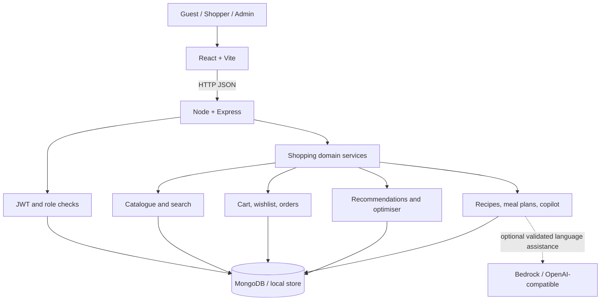
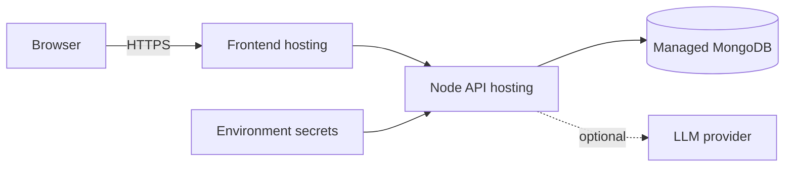

# 3. System Architecture
## Layers
1. Presentation: React application built with Vite.
2. API: Express REST routes and middleware.
3. Domain: authentication, catalogue, cart, orders, recommendations, recipes, substitutions, optimiser, copilot.
4. Persistence: MongoDB/Mongoose or local file-backed development store.
5. External integration: optional Bedrock or OpenAI-compatible LLM.

## Request lifecycle
Browser action → API request → parsing/authentication/authorization → route validation → domain service → configured store → JSON response → client update. Optional LLM calls are bounded by validation and fallback handling.

## Authentication
Registration/login use password hashing and JWT. Protected routes require bearer credentials. Admin routes require the administrator role. Guest carts use a guest identifier and are distinct from authenticated carts.

## Recommendation and copilot
Recommendation scores combine content similarity, consent-permitted purchase history, unit value, discount, popularity, and budget fit using hand-set weights. This is deterministic scoring, not trained ML. Copilot routes intents to tools; an optional LLM may interpret language or phrase a response. Zod/schema validation and deterministic fallbacks protect core logic.

## Deployment view

Actual provider, domain, TLS, and topology depend on the final deployment.
