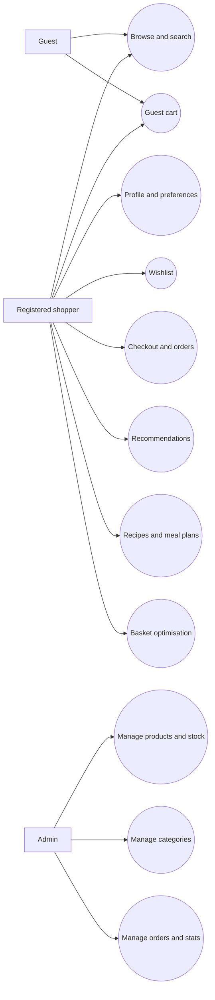
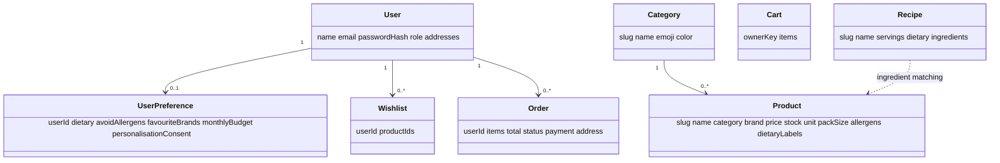
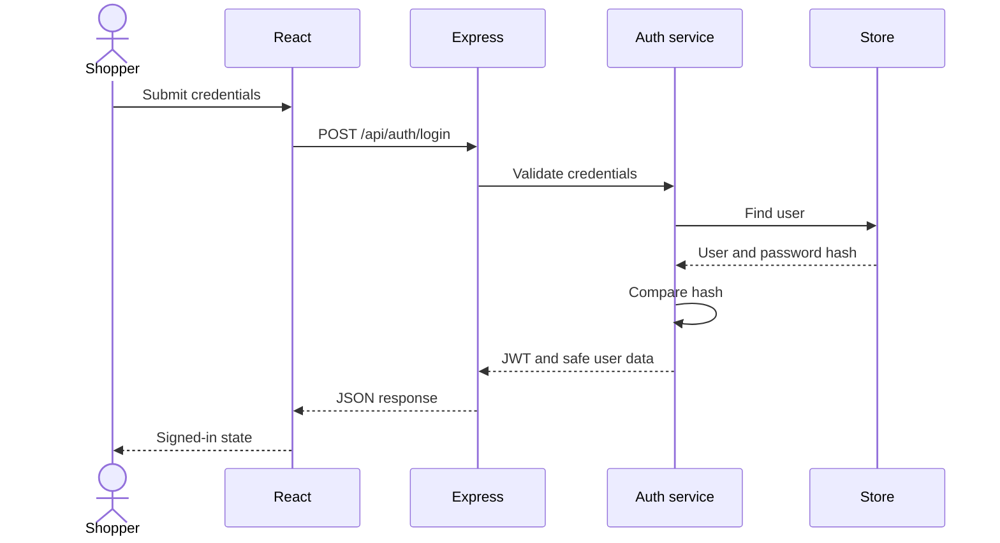
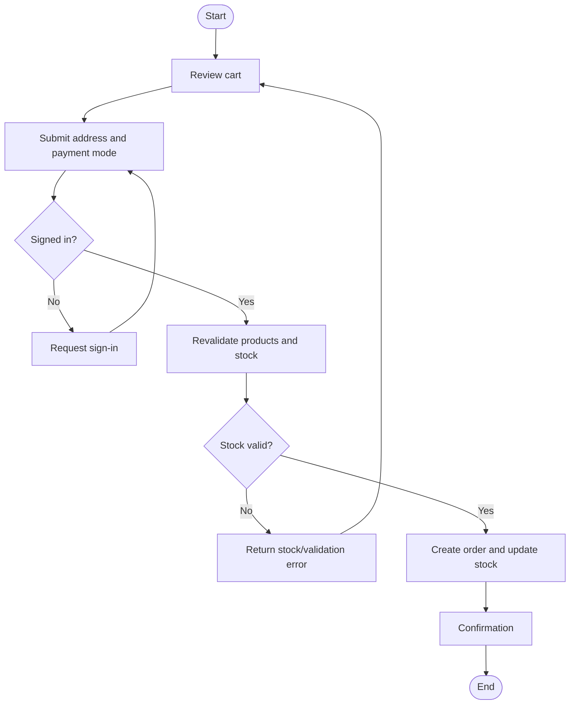
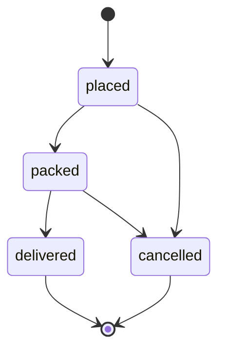

# 4. UML Diagrams
These are documentation-level Mermaid models of the supplied web application.

## Use cases

## Domain class model

## Login sequence

## Checkout activity

## Order lifecycle

