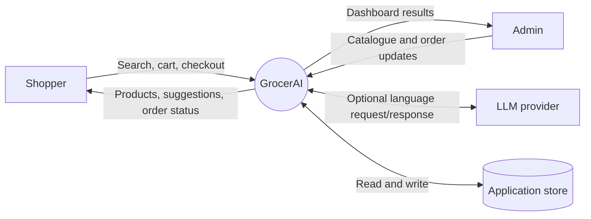
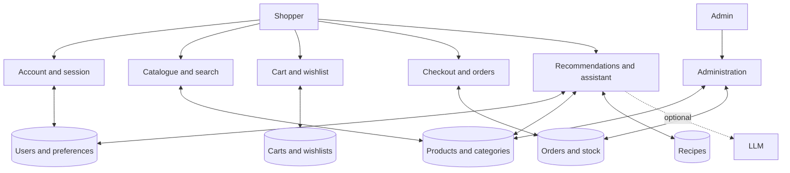
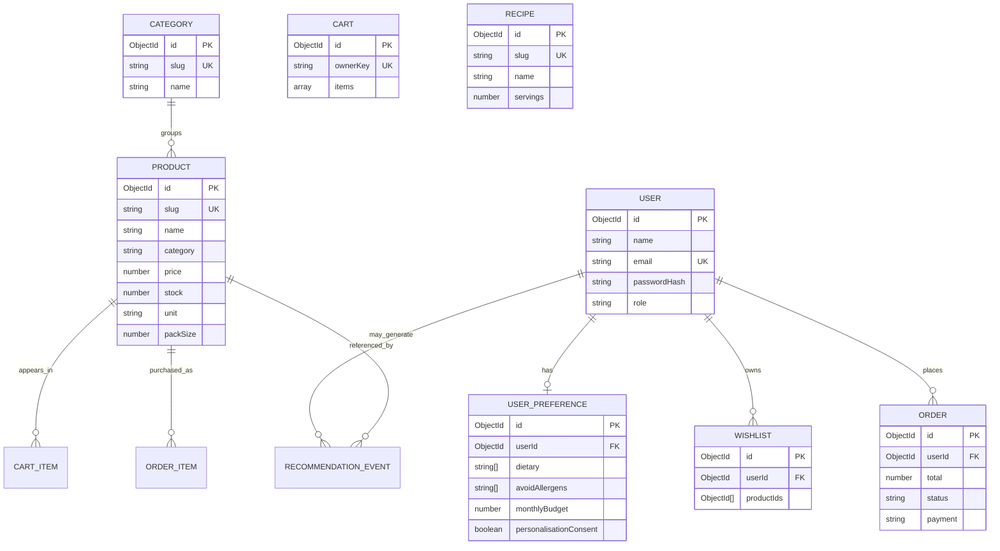

# 5. Data Flow and ER Diagrams
## DFD Level 0

## DFD Level 1

## ER diagram

## Explanation
Account flows access user/preferences. Catalogue reads products/categories. Cart uses `u:<userId>` or `g:<guestId>`. Checkout revalidates stock and creates an order. Recommendation/recipe services read product, preference, and recipe data. Admin actions update catalogue, stock, categories, and orders.
